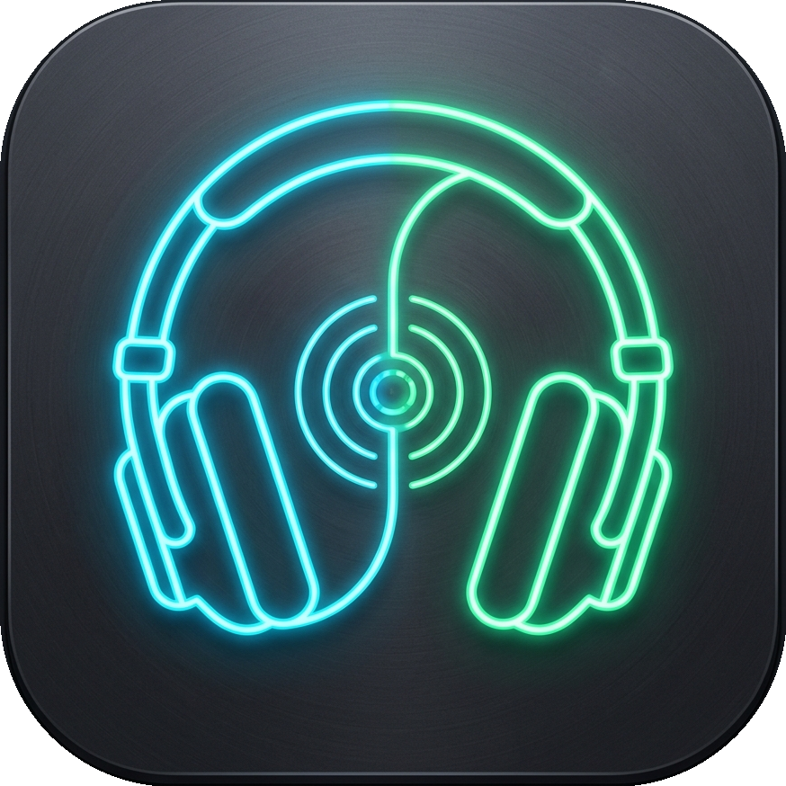

<p align="center">
  
</p>

# Dual Audio Mirror ⚡

Ultra-lightweight, zero-bloat native Windows WASAPI audio mirror designed specifically to duplicate audio to two headphones or outputs simultaneously with near-zero latency.

Replaces VoiceMeeter's bloated 90s GUI, EQ filters, Intellipan, and 30-day donation popups with a clean, standalone native executable.

---

## Features

- **Simultaneous Dual Playback:** Routes audio in parallel to any two playback outputs / headphones simultaneously.
- **Smart Auto-Detection:** Automatically discovers your audio endpoints and pairs default outputs seamlessly on startup.
- **Independent Volume & Mute:** Adjust individual volume sliders (0% to 125% boost) and toggle quick mutes for either channel independently.
- **Real-Time LED VU Meters:** Live animated peak level meters for Master Input, Channel 1, and Channel 2.
- **Ultra-Low Latency:** Native 48.0 kHz 32-bit float stereo audio pipeline running via MMCSS `Pro Audio` priority (<10-15ms buffer).
- **System Tray Integration:** Click "Send to Tray" to minimize quietly into the Windows taskbar tray. Right-click tray icon to show dashboard or exit.
- **Windows Startup Toggle:** Checkbox to launch automatically on Windows login.
- **Self-Contained:** Compiles directly with Windows' built-in C# compiler (`csc.exe`). Zero external runtimes or dependencies needed.

---

## Architecture & How It Works

```
   [ Windows Audio / Games / Discord / Spotify ]
                         │
                         ▼
        [ Voicemeeter Input (or Default Device) ]
                         │
                 WASAPI Loopback
                         │
                         ▼
             [ DualAudioMirror Engine ]
           (MMCSS Real-Time Priority Thread)
                   │             │
        (Volume1 & Mute)     (Volume2 & Mute)
                   │             │
                   ▼             ▼
          [ Headphones PRO X ]  [ Headphones G435 ]
```

---

## Build & Run

### Running
Double-click `DualAudioMirror.exe` or run:
```powershell
.\DualAudioMirror.exe
```

### Rebuilding from Source
Run the included build script:
```cmd
build.bat
```
*(Uses the native 64-bit .NET compiler built into Windows — no Visual Studio or external tools required).*
